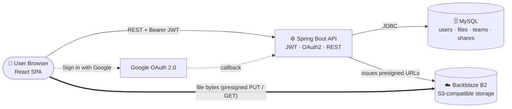
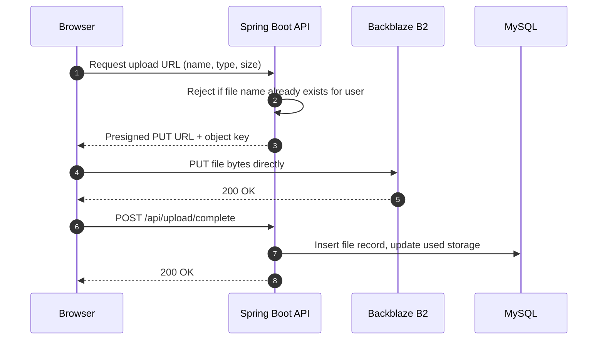

<div align="center">


<br />
<br />

**Secure, team-ready cloud storage — files go straight from your browser to object storage, never through your server.**

<br />

[](https://react.dev/)
[](https://vite.dev/)
[](https://tailwindcss.com/)
[](https://spring.io/projects/spring-boot)
[](https://openjdk.org/projects/jdk/21/)
[](https://www.mysql.com/)
[](https://www.backblaze.com/cloud-storage)

[Features](#-features) ·
[Architecture](#-architecture) ·
[Getting Started](#-getting-started) ·
[API Reference](#-api-reference) ·
[Project Structure](#-project-structure) ·
[Roadmap](#-roadmap)

</div>

<br />

## 📖 Overview

**Cloud Port** is a full-stack cloud storage platform in the spirit of Google Drive: upload files, organise them, share them with individual people, and collaborate through teams.

What sets it apart is *how* files move. The Spring Boot API never proxies file bytes. Instead it issues short-lived **presigned URLs**, and the browser transfers data directly to and from [Backblaze B2](https://www.backblaze.com/cloud-storage) over its S3-compatible API. The backend stays light, uploads stay fast, and large files are handled with resumable-style **multipart uploads**.

> Developed as part of a dissertation project.

<br />

## ✨ Features

| | Feature | Details |
|---|---|---|
| 🔐 | **Flexible authentication** | Email + password (BCrypt-hashed) or **Sign in with Google** (OAuth 2.0). Sessions use stateless **JWTs** with a 24-hour lifetime. |
| ⚡ | **Direct-to-storage transfers** | Uploads and downloads use presigned URLs, so file data bypasses the API entirely. |
| 📦 | **Smart large-file uploads** | Files up to 100 MB use a single presigned `PUT`. Larger files are split into 5 MB parts, uploaded individually, and assembled by B2. Failed uploads are aborted to avoid orphaned parts. |
| 📊 | **Live progress** | Per-file progress bars with status messages for every stage of an upload. |
| 🔎 | **Instant search** | Search across your own files by name. |
| 🤝 | **File sharing** | Share a file with another registered user, or with a whole team, from a single modal. |
| 👥 | **Teams** | Create teams, add members by email, view the member list, and leave or disband a team. |
| 📥 | **Shared views** | Dedicated *Shared With Me* and *Team Shares* views keep incoming files separate from your own. |
| 💾 | **Storage quotas** | Per-user usage is tracked server-side and surfaced as a usage bar in the dashboard. |
| 📱 | **Responsive UI** | Built with Tailwind CSS; the dashboard adapts from desktop to mobile. |

<br />

## 🏗 Architecture



### Upload flow



For files over 100 MB the browser instead starts a multipart upload, requests a presigned URL **per 5 MB part**, uploads each part directly to B2, collects the returned `ETag`s, and asks the API to complete the upload.

### Design decisions

- **Presigned URLs over proxying** — the API never touches file bytes, which keeps memory and bandwidth costs off the server. Upload URLs are valid for 24 hours; download URLs for 60 minutes.
- **Per-user object namespace** — objects are stored under `{userId}/{fileName}`, isolating each user's files.
- **Stateless auth** — a JWT carries the user's email, username and storage figures, so the dashboard can render without an extra round trip.
- **Plain JDBC** — data access uses Spring's `JdbcTemplate` with explicit SQL and parameterised queries.
- **Self-configuring bucket** — on startup the API applies the CORS rules the browser needs to talk to the bucket directly.

<br />

## 🧰 Tech Stack

<table>
<tr>
<td valign="top" width="50%">

### Frontend — `cloud-port/`
- **React 19** with the **React Compiler**
- **Vite 7** build tooling
- **React Router 7** (protected routes)
- **Tailwind CSS 4** + **styled-components**
- **React Icons**
- **ESLint 9**
- Deployed to **Vercel** (SPA rewrites included)

</td>
<td valign="top" width="50%">

### Backend — `cloudport/`
- **Java 21** · **Spring Boot**
- **Spring Security** (JWT filter + OAuth2 client)
- **Spring JDBC** · **MySQL**
- **AWS SDK v2 (S3)** against Backblaze B2
- **jjwt** for token signing and parsing
- **jBCrypt** for password hashing
- **Lombok** · **Maven** wrapper included

</td>
</tr>
</table>

<br />

## 🚀 Getting Started

### Prerequisites

| Tool | Version |
|---|---|
| Node.js | 20+ |
| Java (JDK) | 21 |
| MySQL | 8+ |
| Backblaze B2 account | A bucket plus an application key |
| Google Cloud project | OAuth 2.0 client credentials *(only for Google sign-in)* |

### 1. Clone

```bash
git clone https://github.com/Temuulen-ts/cloudport_back.git   # backend
git clone https://github.com/Temuulen-ts/Cloudport_f.git       # frontend
```

### 2. Set up the database

Create a MySQL database and apply the [reference schema](#-database-schema) below.

### 3. Configure and run the backend

Create `cloudport/src/main/resources/application.properties` (or supply the same keys as environment variables):

```properties
spring.application.name=cloudport

# Backblaze B2 (S3-compatible)
b2.access_key=<your-b2-key-id>
b2.secret_key=<your-b2-application-key>
b2.endpoint=https://s3.<region>.backblazeb2.com
b2.bucket=<your-bucket-name>

# MySQL
spring.datasource.url=jdbc:mysql://localhost:3306/<database>
spring.datasource.username=<db-user>
spring.datasource.password=<db-password>
spring.datasource.driver-class-name=com.mysql.cj.jdbc.Driver

# Google OAuth 2.0
spring.security.oauth2.client.registration.google.client-id=<google-client-id>
spring.security.oauth2.client.registration.google.client-secret=<google-client-secret>
spring.security.oauth2.client.registration.google.scope=profile,email
spring.security.oauth2.client.registration.google.redirect-uri=<backend-url>/login/oauth2/code/google

# App settings
allowed-origins=http://localhost:5173
jwt-util=<long-random-secret-at-least-32-chars>
```

> ⚠️ **Never commit real credentials.** Keep `application.properties` out of version control (add it to `.gitignore`) and prefer environment variables or a secrets manager in production. Generate the JWT secret with `openssl rand -base64 48`.

Then start the API:

```bash
cd cloudport
./mvnw spring-boot:run
```

The API listens on `http://localhost:8080` by default.

### 4. Configure and run the frontend

```bash
cd cloud-port
npm install
```

Create a `.env` file:

```env
VITE_API_BASE_URL=http://localhost:8080
```

```bash
npm run dev
```

Open **http://localhost:5173** and create an account.

### Scripts

| Command | Description |
|---|---|
| `npm run dev` | Start the Vite dev server with HMR |
| `npm run build` | Produce an optimised production build in `dist/` |
| `npm run preview` | Serve the production build locally |
| `npm run lint` | Run ESLint |
| `./mvnw spring-boot:run` | Run the backend in development |
| `./mvnw clean package` | Build the executable backend JAR |

<br />

## 📡 API Reference

All endpoints except `/auth/**`, `/oauth2/**` and `/login/**` require an `Authorization: Bearer <jwt>` header.

<details open>
<summary><b>🔑 Authentication</b></summary>

| Method | Endpoint | Description |
|---|---|---|
| `POST` | `/auth/register` | Create an account with email and password |
| `POST` | `/auth/login` | Exchange credentials for a JWT |
| `GET` | `/oauth2/authorization/google` | Begin Google sign-in; the API redirects back to the SPA at `/oauth-success?token=…` |

</details>

<details open>
<summary><b>📤 Uploads</b></summary>

| Method | Endpoint | Description |
|---|---|---|
| `GET` | `/api/upload/url` | Presigned `PUT` URL for a single-request upload |
| `POST` | `/api/upload/multipart/start` | Begin a multipart upload; returns `uploadId` and `key` |
| `GET` | `/api/upload/multipart/part-url` | Presigned URL for one part |
| `POST` | `/api/upload/multipart/complete` | Assemble the uploaded parts |
| `DELETE` | `/api/upload/multipart/abort` | Abort and clean up a multipart upload |
| `POST` | `/api/upload/complete` | Register a finished upload and update used storage |
| `GET` | `/api/upload/get` | List the current user's files |
| `DELETE` | `/api/upload/delete` | Delete a file (owner only) and release its storage |

</details>

<details open>
<summary><b>📥 Downloads</b></summary>

| Method | Endpoint | Description |
|---|---|---|
| `GET` | `/api/download/url` | Presigned download URL for one of your files |
| `GET` | `/api/download/sharedurl` | Presigned download URL for a file shared with you |

</details>

<details open>
<summary><b>🤝 Sharing, Teams & Search</b></summary>

| Method | Endpoint | Description |
|---|---|---|
| `POST` | `/api/share` | Share a file with a user or a team |
| `GET` | `/api/share/get` | Files shared with the current user |
| `GET` | `/api/teams/get` | Teams the user administers or belongs to |
| `POST` | `/api/teams/create` | Create a team |
| `POST` | `/api/teams/{teamId}/addMember` | Add a member by email |
| `GET` | `/api/teams/{teamId}/members` | List team members |
| `POST` | `/api/teams/{teamId}/leave` | Leave a team (admins disband it) |
| `GET` | `/api/teams/teamFiles` | Files shared into the user's teams |
| `GET` | `/search?query=` | Search the user's files by name |

</details>

<br />

## 🗄 Database Schema

The repository does not ship migrations, so this reference schema is derived from the SQL used by the repositories. Adjust types and defaults to taste.

<details>
<summary><b>Show schema</b></summary>

```sql
CREATE TABLE users (
  id            CHAR(36)     PRIMARY KEY,
  username      VARCHAR(255) NOT NULL,
  email         VARCHAR(255) NOT NULL UNIQUE,
  password_hash VARCHAR(255),                       -- NULL for Google-only accounts
  created_at    DATETIME     NOT NULL,
  storage_bytes BIGINT       NOT NULL DEFAULT 5368709120,
  used_bytes    BIGINT       NOT NULL DEFAULT 0
);

CREATE TABLE files (
  id          CHAR(36)     PRIMARY KEY,
  owner_id    CHAR(36)     NOT NULL,
  file_name   VARCHAR(512) NOT NULL,
  file_type   VARCHAR(255),
  size_bytes  BIGINT       NOT NULL,
  b2_path     VARCHAR(1024) NOT NULL,
  uploaded_at DATETIME     NOT NULL,
  UNIQUE KEY uq_owner_file (owner_id, file_name),
  FOREIGN KEY (owner_id) REFERENCES users(id) ON DELETE CASCADE
);

CREATE TABLE file_shares (
  id             CHAR(36) PRIMARY KEY,
  file_id        CHAR(36) NOT NULL,
  owner_id       CHAR(36) NOT NULL,
  shared_with_id CHAR(36) NOT NULL,
  UNIQUE KEY uq_share (file_id, shared_with_id),
  FOREIGN KEY (file_id)        REFERENCES files(id) ON DELETE CASCADE,
  FOREIGN KEY (shared_with_id) REFERENCES users(id) ON DELETE CASCADE
);

CREATE TABLE teams (
  id         CHAR(36)     PRIMARY KEY,
  admin_id   CHAR(36)     NOT NULL,
  name       VARCHAR(255) NOT NULL,
  created_at TIMESTAMP    NOT NULL DEFAULT CURRENT_TIMESTAMP,
  FOREIGN KEY (admin_id) REFERENCES users(id) ON DELETE CASCADE
);

CREATE TABLE team_members (
  team_id   CHAR(36) NOT NULL,
  member_id CHAR(36) NOT NULL,
  PRIMARY KEY (team_id, member_id),
  FOREIGN KEY (team_id)   REFERENCES teams(id) ON DELETE CASCADE,
  FOREIGN KEY (member_id) REFERENCES users(id) ON DELETE CASCADE
);

CREATE TABLE team_shares (
  id      CHAR(36) PRIMARY KEY,
  team_id CHAR(36) NOT NULL,
  file_id CHAR(36) NOT NULL,
  UNIQUE KEY uq_team_share (team_id, file_id),
  FOREIGN KEY (team_id) REFERENCES teams(id) ON DELETE CASCADE,
  FOREIGN KEY (file_id) REFERENCES files(id) ON DELETE CASCADE
);
```

</details>

<br />

## 📁 Project Structure

```text
.
├── cloud-port/                     # ⚛️  Frontend (React + Vite)
│   ├── src/
│   │   ├── Pages/                  #   Login, Signup, Dashboard, OAuth callback
│   │   ├── components/             #   MyDrive, SharedWithMe, Team, MyTeamShares, forms
│   │   ├── services/               #   AuthService, Upload (single + multipart logic)
│   │   ├── utils/                  #   ProtectedRoutes, JWT decoding, config
│   │   └── assets/                 #   Logo and login artwork
│   ├── vercel.json                 #   SPA rewrite rules
│   └── vite.config.js
│
└── cloudport/                      # ☕ Backend (Spring Boot)
    └── src/main/java/com/dissertation/cloudport/
        ├── api/controller/         #   REST controllers (auth, upload, download, share, teams, search, users)
        ├── Service/                #   Business logic
        ├── Repository/             #   JdbcTemplate data access
        ├── Config/                 #   Security (CORS, filter chain) and B2/S3 client beans
        ├── utils/                  #   JWT filter + util, OAuth2 success handler, password hashing
        ├── dto/  model/            #   Request/response and domain objects
        └── B2CorsInitializer.java  #   Applies bucket CORS rules on startup
```

<br />

## 🔒 Security

- Passwords are hashed with **BCrypt** and never stored or returned in plain text.
- API access is gated by a signed **JWT** (HS256, 24-hour expiry) validated on every request by a dedicated filter.
- **CORS** is restricted to the configured `allowed-origins`.
- Presigned URLs are **time-limited**, and object keys are namespaced per user.
- Uploads of a file name that already exists for the user are rejected.

Found a vulnerability? Please open a private security advisory instead of a public issue.

<br />

## 🗺 Roadmap

- [ ] Folders and nested directory structure
- [ ] File previews (images, PDFs, video)
- [ ] Public share links with expiry
- [ ] Role-based team permissions
- [ ] Trash and file version history
- [ ] Automated test suite and CI pipeline
- [ ] Containerised deployment with Docker Compose

<br />

## 🤝 Contributing

Contributions are welcome.

1. Fork the repository
2. Create a feature branch: `git checkout -b feature/amazing-feature`
3. Commit your changes: `git commit -m "Add amazing feature"`
4. Push the branch: `git push origin feature/amazing-feature`
5. Open a pull request

<br />

## 📄 License

Distributed under the **MIT License**. See [`LICENSE`](LICENSE) for details.

<br />

<div align="center">

Built by [**Temuulen**](https://github.com/Temuulen-ts)

<sub>If you find this project useful, consider giving it a ⭐</sub>

</div>

<!--
Add screenshots once you have them (they make a big difference). Create docs/screenshots/ and uncomment:

## 🖼 Screenshots

| Login | My Drive |
|---|---|
|  |  |

| Sharing | Teams |
|---|---|
|  |  |
-->
